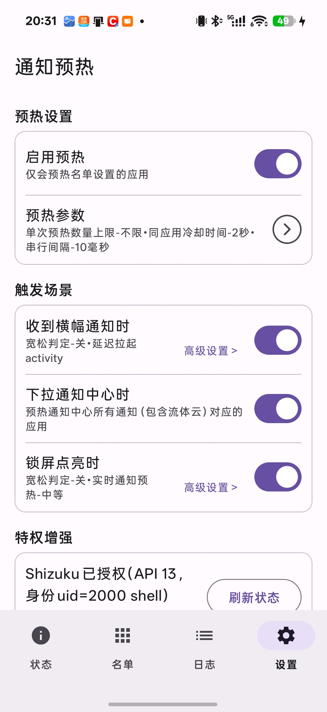
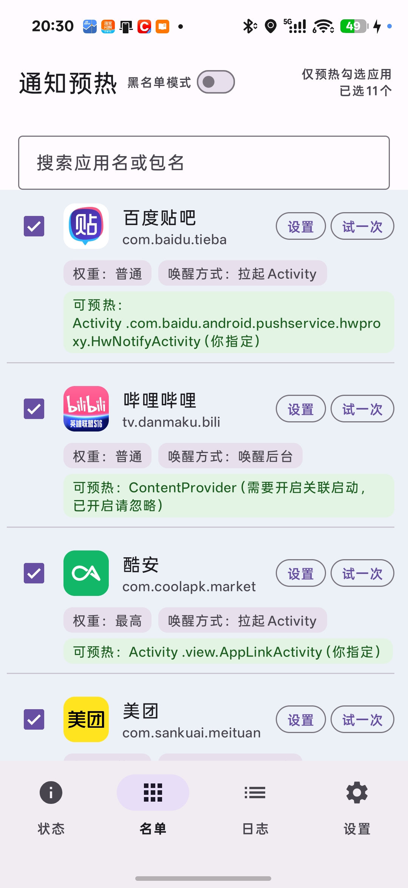
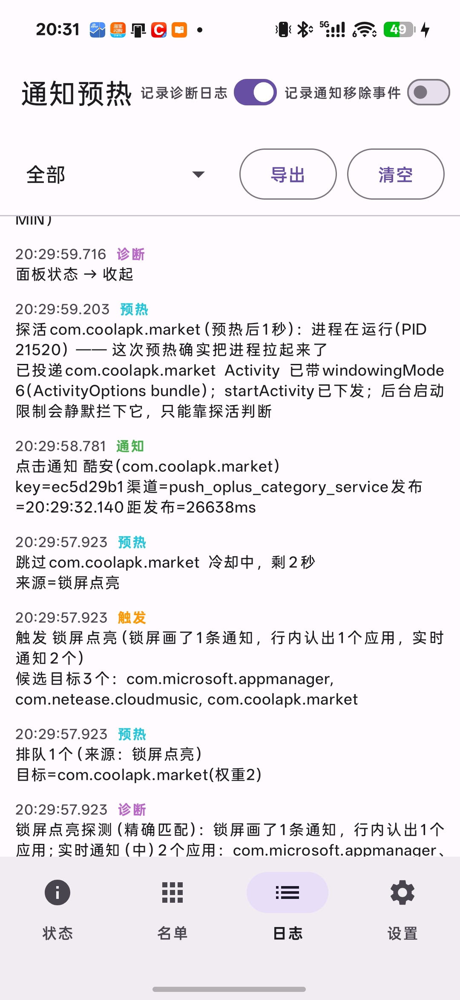
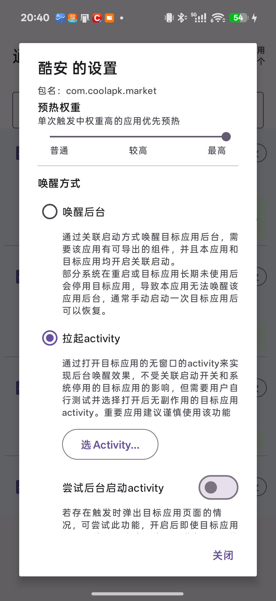

# 通知预热

本应用开发初衷是解决ColorOS中点开通知时过渡动画缺失问题，通过在下拉通知面板、锁屏点亮、收到横幅通知时，预先唤醒发通知的应用的后台进程， 避免点开通知时因进程冷启动而卡顿。使用该应用可能导致耗电增加。

本项目代码由 AI 生成。项目的设计与测试由本人完成。

## 主要功能

- 在拉开通知中心、点亮锁屏或收到横幅通知时，提前把对应应用在后台准备好，减少点开通知时的等待和卡顿。
- 可以只处理勾选的应用，也可以排除不想处理的应用；每个应用还能单独调整唤醒方式和优先级。
- 收到横幅、下拉通知中心、锁屏点亮三个场景都能单独开关。
- 日志会记录触发、预热和点击时间，方便判断是没准备好就点了，还是准备好后仍然慢。
- 应用不联网，不会收集您的信息；设置和日志只保存在本机。

## 界面预览

| 设置 | 应用名单 |
| :---: | :---: |
|  |  |

| 运行日志 | 单个应用设置 |
| :---: | :---: |
|  |  |

## 赞赏

如果觉得本项目对您有帮助，欢迎支持一下作者。

  

